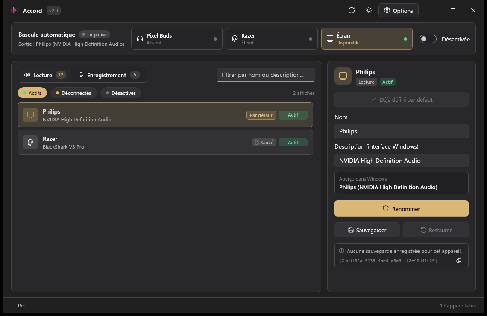

# Accord

Utilitaire Windows 11 en **WinUI 3 / .NET 10** pour renommer durablement les périphériques audio Windows (registre `MMDevices` + `SWD\MMDEVAPI` + panneau Son `mmsys.cpl`), sauvegarder/restaurer leurs noms au démarrage et gérer la **bascule automatique du son et du micro** selon les casques réellement actifs.



## Fonctionnalités

- **Inventaire et renommage durable (Lecture & Enregistrement)**
  - Filtrage par état (**Actifs**, **Déconnectés**, **Désactivés**) et recherche instantanée (les profils `Hands-Free` et cachés sont masqués).
  - Modification du **Nom** et de la **Description** avec aperçu temps réel, prise de propriété temporaire sur les clés protégées `MMDevices` suivie de la restauration exacte du descripteur de sécurité (`SDDL`), redémarrage propre du service `Audiosrv` et réapplication immédiate du nom d'interface dans `mmsys.cpl` via COM `IPolicyConfig`.
  - Définition comme périphérique par défaut (Multimédia + Communications) en un clic sans élévation.
- **Sauvegarde et restauration au démarrage**
  - Sauvegarde individuelle au format compatible `Accord.backup.txt` (incluant les identifiants matériels `Hw` / `Wave` pour résister aux changements de GUID Windows).
  - Restauration unitaire, restauration globale à la demande ou automatique à l'ouverture de session via la tâche planifiée `AccordRestauration` (exécutée nativement par `Accord.Admin.exe --restore-boot`).
- **Bascule automatique du son (`Accord.Watcher.exe`)**
  - Surveillance légère en arrière-plan (instance unique, sans fenêtre, journal rotatif à 512 Ko).
  - Détection matérielle réelle : **Pixel Buds** via l'état Bluetooth natif (`SetupAPI` / `CfgMgr32`), **Razer BlackShark V3 Pro** via requête HID 2,4 GHz directe sur le dongle (`VID_1532` / `PID_0577` / `col04`), et **Écran (Philips Evnia)** en sortie de repli.
  - Règles de priorité : dernier casque connecté gagnant, bascule sortie + micro (Multimédia et Communications), réparation silencieuse des noms (`RepairSavedNames`), forçage manuel en un clic depuis le bandeau supérieur et personnalisation optionnelle des cibles dans **Options**.
- **Interface Windows 11 native & 0 prérequis**
  - Fond **Mica**, barre de titre personnalisée, accent système Windows 11, mode **Clair / Sombre** mémorisé, tiroir **Options** intégré et instance unique.
  - Exécution de l'interface en utilisateur standard avec élévation UAC ponctuelle via `Accord.Admin.exe` (Named Pipe sécurisé `AuthenticatedUserSid` + repli fichier).
  - Compatible mode **portable** (configuration à côté de l'exécutable) et installation **`Program Files`** (données partagées dans `%ProgramData%\Accord\`).

## Structure du projet

```text
accord/
├── Accord.slnx                 # Solution .NET 10 (x64)
├── build.ps1                   # Publication self-contained partagée + compilation Inno Setup 6
├── assets/                     # Icônes multi-résolutions (accord.ico, accord.png)
├── installer/
│   └── Accord.iss              # Script Inno Setup 6 (Program Files, Menu Démarrer, ProgramData)
├── src/
│   ├── Accord.Core/            # Core Audio COM, Registre, Razer HID, Bluetooth, Switcher, IPC, AppPaths
│   ├── Accord.App/             # Interface WinUI 3 (WindowsAppSDK self-contained, asInvoker)
│   ├── Accord.Watcher/         # Agent de bascule auto & réparation des noms (asInvoker)
│   └── Accord.Admin/           # Module privilégié registre / Audiosrv / tâche boot (requireAdministrator)
└── legacy/                     # Archive des anciens binaires et scripts PowerShell/VBS
```

## Compilation et installateur

Prérequis de build : **.NET 10 SDK** et **Inno Setup 6** (`ISCC.exe`). Aucun prérequis côté utilisateur final.

```powershell
# Compiler uniquement le dossier portable publish/
.\build.ps1 -SkipInstaller

# Compiler publish/ + l'installateur dist\Accord-Setup-2.0.0.exe
.\build.ps1
```

## Modes CLI utiles

```powershell
# Diagnostic de la détection matérielle (Pixel Bluetooth / Razer HID / Écran) sans modifier le son
.\publish\Accord.Watcher.exe --test-only

# Simulation en lecture seule de la restauration complète au démarrage
.\publish\Accord.Admin.exe --restore-boot --test-only
```
