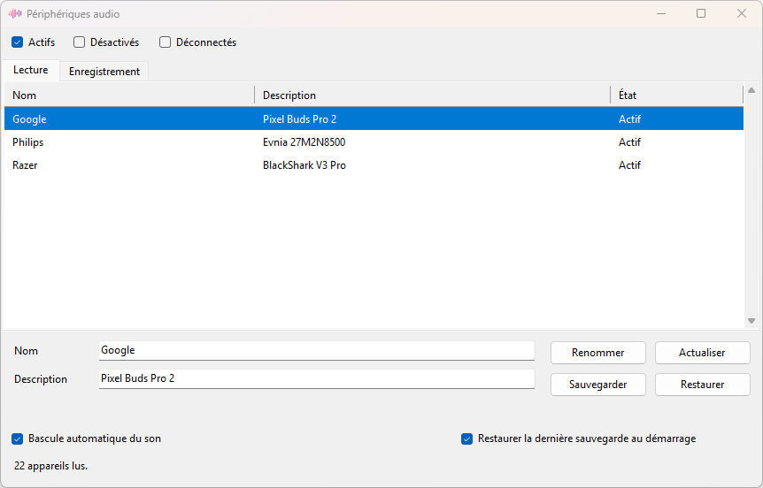

# AudioRename

Renomme les périphériques audio de Windows, et garde ces noms. Dès que Windows 11 remet un nom par défaut, le logiciel remet le nom enregistré. Le nom court apparaît dans la barre des tâches. La description est celle du panneau Son.



## Utilisation

Lancer `AudioRename.exe`. Windows demande les droits administrateur : les noms sont dans une clé du registre protégée, et le service Audio est redémarré une seconde le temps d'écrire le nom du panneau Son.

- **Lecture** et **Enregistrement**.
- **Actifs**, **Désactivés**, **Déconnectés**. Au lancement, seule **Actifs** est cochée.
- Sélectionner un appareil, modifier **Nom** et **Description**, puis **Renommer**.
  - La barre des tâches affiche `Nom (Description)`.
  - Le panneau Son affiche la description.
- **Actualiser** relit la liste.
- **Sauvegarder** enregistre l'appareil sélectionné dans `AudioRename.backup.txt`, à côté du programme. Le son n'est pas coupé. Chaque appareil a sa sauvegarde.
- **Restaurer** remet la sauvegarde de l'appareil sélectionné. Le bouton reste grisé tant qu'il n'y en a pas.
- Le numéro de version s'affiche en bas à droite.

**Restaurer la dernière sauvegarde au démarrage** crée la tâche `AudioRenameAutoRestore`. Elle s'exécute 15 secondes après l'ouverture de session, avec les droits administrateur, et réécrit les noms sauvegardés, sans fenêtre.

**Bascule automatique du son** surveille les casques et change le périphérique par défaut, sans couper le son :

| Branché | Lecture | Micro |
| --- | --- | --- |
| Pixel Buds | stéréo | Pixel Buds |
| Razer BlackShark allumé | Game | Chat |
| aucun des deux | Philips Evnia | inchangé |

Si les deux casques sont là, le dernier connecté gagne. Au démarrage, l'ordre est Pixel, puis Razer, puis l'écran. Les appareils renommés sont reconnus par la sauvegarde, pas par leur ancien nom Windows. Le Razer n'est pris que s'il est vraiment allumé, pas seulement si le dongle est branché.

Dès que Windows 11 remet le nom par défaut d'un appareil sauvegardé, la bascule le remet tout de suite, puis autant de fois que nécessaire, sans couper le son. Fermer AudioRename ne l'arrête pas. Elle se relance à l'ouverture de session, sans fenêtre, via `Bascule\AudioRename.exe`. Il lui faut aussi `AutoAudioSwitch.ps1`, `RazerDongle.cs`, `Start-RestoreAudioNames.vbs` et `Modules`.

## Installation

Télécharger `AudioRename-1.2.1.zip` depuis les [releases](https://github.com/yoyo1306/AudioRename/releases), le décompresser, puis lancer `AudioRename.exe`. Garder les fichiers ensemble.

## Compilation

Windows, compilateur 64 bits du .NET Framework 4. Le compilateur 32 bits ne voit pas la bonne vue du registre.

```
C:\WINDOWS\Microsoft.NET\Framework64\v4.0.30319\csc.exe /nologo /target:winexe /optimize+ /win32manifest:app.manifest /win32icon:AudioRename.ico /out:AudioRename.exe /reference:System.Windows.Forms.dll /reference:System.Drawing.dll /reference:System.ServiceProcess.dll AudioRename.cs
```

Le lanceur de la bascule, sans droits administrateur :

```
C:\WINDOWS\Microsoft.NET\Framework64\v4.0.30319\csc.exe /nologo /target:winexe /optimize+ /win32icon:AudioRename.ico /out:Bascule\AudioRename.exe Bascule\AudioRenameBascule.cs
```

## Crédits

Le changement de périphérique par défaut utilise [AudioDeviceCmdlets](https://github.com/frgnca/AudioDeviceCmdlets) 3.1.0.2, © 2016–2022 François Gendron, licence MIT.
